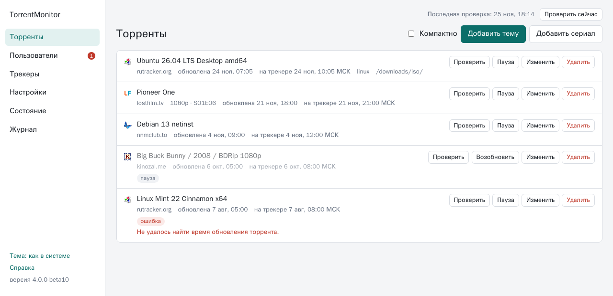
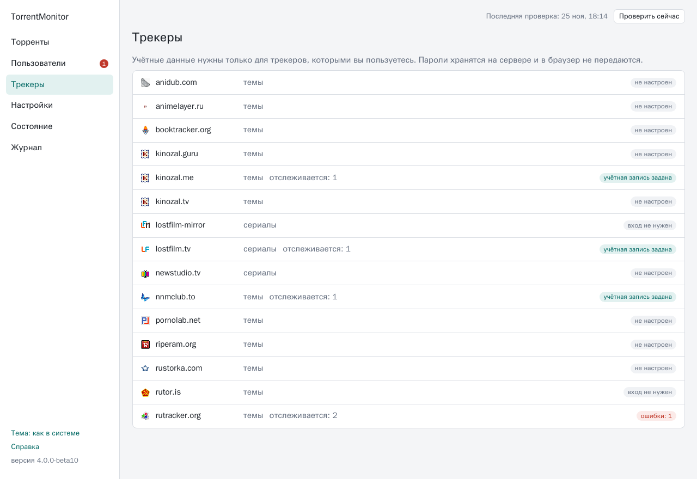
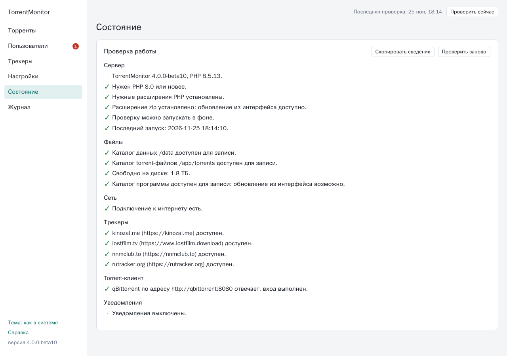
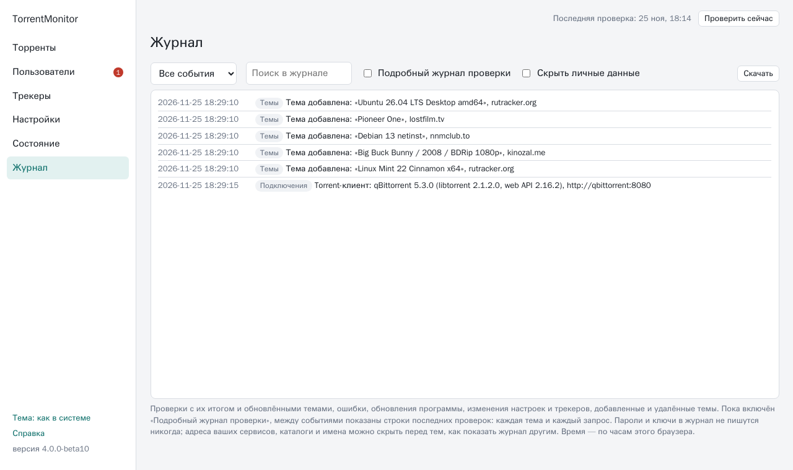

# TorrentMonitor
Приложение мониторит изменения на популярных торрент-трекерах рунета и автоматизирует закачку обновлений (сериалы, раздачи которые ведутся *путем добавления новых серий/новых версий*, перезалитые торрент-файлы и т.д.)

Это продолжение проекта [ElizarovEugene/TorrentMonitor](https://github.com/ElizarovEugene/TorrentMonitor) Евгения Елизарова.

### Документация и версии:
* [Вики](https://github.com/azinchen/TorrentMonitor/wiki)
* [Версии и список изменений](https://github.com/azinchen/TorrentMonitor/releases)

### Список возможностей приложения:
- Слежение за темами
  - anidub.com
  - animelayer.ru
  - booktracker.org
  - kinozal.me / kinozal.guru
  - lostfilm.tv
  - newstudio.tv
  - nnmclub.to
  - pornolab.net
  - riperam.org
  - rustorka.com
  - rutor.is
  - rutracker.org
- Слежение за релизерами
  - booktracker.org
  - nnmclub.to
  - pornolab.net
  - rutracker.org
- Поиск новых серий (SD/HD 720/HD 1080 версии на выбор)
  - lostfilm.tv (+ собственное зеркало)
  - newstudio.tv
- Работа через proxy (SOCKS5/HTTP), зеркала трекеров, FlareSolverr/Byparr для Cloudflare
- Управление торрент-клиентами (добавление/удаление раздач и файлов)
  - Transmission
  - Deluge
  - qBittorrent
  - Synology Download Station
  - TorrServer
- REST API и webhook для Sonarr
- Сервисы уведомлений:
  - E-mail
  - Prowl
  - Pushbullet
  - Pushover
  - Pushall
  - Telegram 
  - Gotify
- RSS-лента
- Выполенение собственных скриптов после обновления раздачи

### Требования для установки:
* Веб-сервер (Apache, nginx, lighttpd); корень сайта — каталог `public/`
* PHP 8.0 или выше с расширениями cURL, mbstring, SimpleXML и zip
* База данных не нужна: настройки и темы хранятся в JSON-файлах в каталоге `data/`

### Docker hub:
https://hub.docker.com/r/alfonder/torrentmonitor

### Скриншоты:

### Лицензия:
[MIT](LICENSE). Сведения о стороннем коде — в файле [NOTICE](NOTICE).
